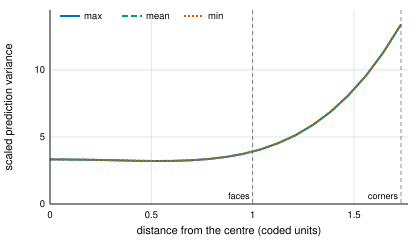
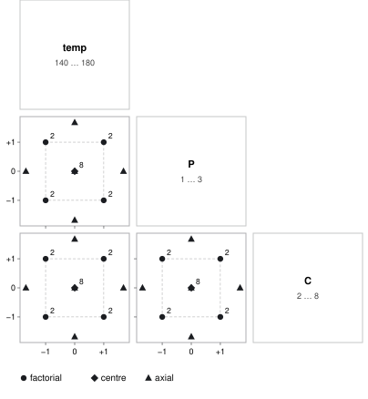
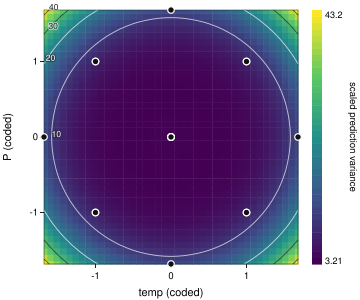

# Concepts

The ideas the rest of the manual relies on. Most textbooks cover them at length; the
[bibliography](bibliography.md) suggests some.

## Factors and coded units

A **factor** is something you set: temperature, gas, time. A continuous factor has a range
(low … high); aikidoe works internally in **coded units**, where the low setting is −1 and the
high +1, so a coefficient means the same thing for every factor: the change in the response from
the centre to the high end. An *effect* — the change from low to high — is twice the coefficient.

For a factor marked *log*, the coding is on the log scale: a dose of 10¹⁵ … 10¹⁶ cm⁻² has its
centre at 3.16 × 10¹⁵, not 5.5 × 10¹⁵. Use it when a factor acts multiplicatively.

A categorical factor's levels are coded by *effect coding* (each level against the average of
all levels); for two levels this is −1 / +1, like a continuous factor.

## Responses and measurement

A **response** is what you measure. How it is measured matters as much as the design:

- **once per run** — one number per run;
- **per wafer, per site** — several readings from each run: they are not replicates of the run
  (they share its settings and its run-to-run error), and aikidoe keeps them apart in a mixed
  model ([wafers and sites](process.md#wafers-and-sites));
- **measurement error** — a gauge R&R study gives the measurement system's σ, which sets a floor
  on what any experiment can detect ([gauge R&R](process.md#gauge-rr)).

## Randomisation and blocking

Runs are done in a **random order** so that anything that drifts — a tool warming up, a
contaminated chamber, a change of operator — is spread across the factors instead of being
mistaken for one of them. aikidoe randomises with the study's seed, so the order is reproducible.

When the runs fall into groups that may differ — days, batches, lots, the stages of a sequential
experiment — they are **blocks**: the design is arranged so that the block differences fall on
effects you can spare (high-order interactions), the runs are randomised within each block, and
the analysis includes a block term.

A **split-plot** design is the restricted randomisation you get when a factor is hard to change:
it is set once for a group of runs (a *whole plot*) and the others vary within it. That changes
the analysis, not just the logistics ([split-plot designs](designs-split-plot.md)).

## Aliasing and resolution

A fraction of a factorial runs only some of the combinations, so some effects cannot be told
apart: they are **aliased**. A regular two-level fraction is defined by its generators — in the
2⁵⁻¹ with `E = ABCD`, the column for E is the product of A, B, C and D — and the *defining
relation* `I = ABCDE` gives every alias: multiply an effect by ABCDE to find its partner
(A = BCDE, AB = CDE, …).

The **resolution** is the length of the shortest word in the defining relation:

| resolution | main effects | two-factor interactions |
|---|---|---|
| III | aliased with 2fis | aliased with main effects |
| IV | clear of 2fis | aliased in pairs |
| V | clear | clear of each other |

Among fractions of the same size and resolution, aikidoe uses the minimum-aberration ones (the
fewest short words). `doe alias` and the Design step show the alias chains.

## Replication and repeated measurement

A **replicate** is a complete new run at the same settings: set up again, run again. Its
variation is the run-to-run error that effects are judged against. Measuring the same run twice
— two sites on a wafer, two readings of a gauge — is a **repeated measurement**: it says how
precise the measurement is, not how repeatable the process is. Treating repeated measurements as
replicates makes every effect look more significant than it is; aikidoe's mixed models avoid it.

Centre points (runs at the middle of every range) replicate cheaply, give a pure-error estimate
and test for curvature.

## Power

The **power** of a test is the chance of detecting an effect of a given size. For a design and a
model, aikidoe computes it from the non-central F distribution: an effect Δ (the change from the
low to the high setting) against run-to-run noise σ, at significance level α (0.05). Power above
0.8 is the usual target. Power depends on Δ/σ, so a good estimate of σ — from earlier data or a
gauge study — matters; for a split-plot the whole-plot variance matters too (η = σ²_wp / σ²).

The Design step shows the power of each term; `doe power` prints it, with the effect detectable
with 80 % power.

**Counts and proportions** ([analysis](analysis.md#counts-and-proportions)) have no single σ: a
count's variance is its mean, a proportion's p(1 − p)/n, so the power depends on how large the
counts or how many the trials are, as well as on the effect. Give the **baseline** — the mean
count (per unit exposure) or the proportion you expect at the centre of the design — and the
effect as a **ratio** from a factor's low to its high setting: a rate ratio for counts, an odds
ratio for proportions. Each term is assessed with the information at the counts or proportions
the model then expects (a Wald test; with an overdispersed count, give θ or the dispersion). Small
counts and few trials carry little information, so replicating runs, plating more volume or
counting more cells helps more than it would for a measurement. `--simulate` checks the
approximation by simulating the experiment and the likelihood-ratio test the analysis will use
(the approximation is usually slightly conservative).

```console
$ doe init cfu.aikidoe.json --factor heat:30:90:s --factor dna:1:10:ng --factor density:0.3:0.9 --response colonies@poisson --seed 4
created cfu.aikidoe.json: 3 factors, 1 responses, seed 4
$ doe design cfu.aikidoe.json --full --replicates 2
cfu.aikidoe.json: full-factorial, 16 runs, randomisation complete, seed 4
$ doe power cfu.aikidoe.json --model 2fi --response colonies --baseline 20 --ratio 1.4 --simulate 300
power for 2fi, poisson (log link): 16 runs, 7 coefficients; α = 0.05; baseline mean count 20
term          df  rate ratio  power   simulated (300)  rate ratio for 80%
------------  --  ----------  ------  ---------------  ------------------
heat           1         1.4  0.8481  0.903 ± 0.017    1.37
dna            1         1.4  0.8481  0.873 ± 0.019    1.37
density        1         1.4  0.8481  0.88 ± 0.019     1.37
heat:dna       1         1.4  0.8481  0.86 ± 0.02      1.37
heat:density   1         1.4  0.8481  0.883 ± 0.019    1.37
dna:density    1         1.4  0.8481  0.88 ± 0.019     1.37
rate ratio: the mean count at a factor's high setting over its low setting; each term assessed alone, with the others at the baseline (Wald test); simulated: the likelihood-ratio test on simulated experiments
```

On the Design step, choose the response in the power section ("for"); the recommender then ranks
the designs by that power. `doe recommend … --response colonies --baseline 20 --ratio 1.4` does
the same.

In a **split-plot** the analysis gives counts and proportions a random whole-plot shift
([random effects](analysis.md#random-effects-for-counts-and-proportions)), so a hard-to-change
factor is judged against how much the whole plots differ, not against the counts' own scatter.
Give that difference as **σ of the whole-plot shift** on the log (counts) or logit (proportions)
scale — 0.3 on the log scale means whole plots typically about 30 % apart — with `--sigma-wp`, or
the Design step's *whole-plot σ*. A factor that changes only between whole plots is then an F test
on (whole plots − such coefficients) df, as in the analysis; the others are χ² tests. The
approximation, at the expected counts, is within a few points of `lme4::glmer` simulations of the
analysis and a little conservative for whole-plot factors; `--simulate` fits the random-effect
model to simulated experiments (slower: a few seconds per hundred). With blocks as well (days, each holding several
whole plots), `--sigma-block` gives their σ, and power follows the analysis with random blocks
and whole plots nested in them. For negative binomial counts give θ as
well (`--theta`): extra scatter within whole plots costs mostly the factors that change within
them. The approximation is then a little more conservative for hard-to-change factors (about 8
points low in a check against simulation), so `--simulate` is worth running.

```console
$ doe init spc.aikidoe.json --factor temp:30:37:°C! --factor dna:1:10:ng --response colonies@poisson --seed 4
created spc.aikidoe.json: 2 factors, 1 responses, seed 4
$ doe design spc.aikidoe.json --full --replicates 6
spc.aikidoe.json: split-plot-full, 24 runs, randomisation restricted, seed 4
split-plot: 12 whole plots of 2 runs; whole-plot (hard-to-change) factors temp are set once per whole plot
$ doe power spc.aikidoe.json --model "temp + dna" --response colonies --baseline 20 --ratio 1.5 --sigma-wp 0.3
power for temp + dna, poisson (log link) with a random whole-plot intercept: 24 runs in 12 whole plots; whole-plot σ = 0.3 on the log scale; α = 0.05; baseline mean count 20
term  df  tested against          rate ratio  power   rate ratio for 80%
----  --  ----------------------  ----------  ------  ------------------
temp   1  whole plots (F, 10 df)         1.5  0.4122  1.931
dna    1  runs (χ²)                      1.5  0.9926  1.293
rate ratio: the mean count at a factor's high setting over its low setting, each term alone, the others at the baseline. A term that changes only between whole plots is judged against the whole-plot variation, an F on 10 df as in the analysis; the others by χ² (Wald approximation at the expected means)
```

With twelve incubator loads (whole plots) of two plates each, the temperature needs a rate ratio
of about 2 for 80 % power; the DNA, varied within each load, about 1.3. The temperature is judged
on the twelve loads: eight plates per load bring its ratio only to 1.84, twenty-four loads of two
plates to 1.52.

## Where the runs are

Before running anything, look at where the runs sit. The Design step draws, for the chosen design
and for the study's own (with any stages added since):

- **every pair of factors** in coded units (−1 low, +1 high): the shape of a mark tells the kind
  of run — factorial, centre, axial, optimal, augmented, confirmation — a number how many runs
  land on the same point in that pair (replicates, centre points), the colour the block or whole
  plot; settings that the [constraints](designs-optimal.md#constraints) rule out are shaded;
- **the prediction variance** over any two factors (below);
- for designs of continuous factors, the **variance dispersion graph** (below).

`doe plot STUDY --pairs | --pv A,B | --vdg` writes the same pictures as SVG files.

### Prediction variance

How precisely a design predicts depends on where you predict. The **scaled prediction variance**
N · Var(ŷ(x))/σ² — the variance of the fitted mean at settings x, times the number of runs, in
units of the run-to-run variance — is low where the runs give much information and rises towards
and beyond the edges. It depends only on the design and the model, so it can be judged before
anything is run. A response-surface design should keep it low and even over the region you care
about; an I-optimal design minimises its average.

The **variance dispersion graph** sums it up for a design of continuous factors: at each distance
from the centre, the smallest, average and largest value over all directions. A rotatable central
composite design has one line (the same in every direction); a Box–Behnken spreads out towards the
corners it leaves out. Plotting it for the candidate designs is the usual way to compare them.

```console
$ doe init vp.aikidoe.json --factor temp:140:180 --factor P:1:3 --factor C:2:8 --response y --seed 3
created vp.aikidoe.json: 3 factors, 1 responses, seed 3
$ doe design vp.aikidoe.json --ccd
vp.aikidoe.json: ccd, 20 runs, randomisation complete, seed 3
α = 1.6818 (rotatable); cube 8 runs; centre points 6
scaled prediction variance (full quadratic) by radius: ρ 0: 3.33, ρ 0.5: 3.21, ρ 1: 3.91, ρ 1.73: 13.4
$ doe plot vp.aikidoe.json --vdg
variance dispersion for quadratic: scaled prediction variance on spheres about the centre
distance  min    mean   max
--------  -----  -----  -----
0         3.327  3.327  3.327
0.346     3.25   3.25   3.25
0.693     3.259  3.259  3.259
1.04      4.074  4.074  4.074
1.39      6.893  6.893  6.893
1.73      13.4   13.4   13.4
wrote vp-vdg.svg
```



The same design pair by pair, and its prediction variance over temperature and pressure with the
concentration at its centre: low and even over the middle, rising towards the axial points and
beyond the corners of the cube, where no runs are.

```console
$ doe plot vp.aikidoe.json --pairs
every pair of temp, P, C: 20 runs (factorial, centre, axial)
wrote vp-pairs.svg
$ doe plot vp.aikidoe.json --pv temp,P
scaled prediction variance for quadratic over temp and P, the other factors at their centre: 3.209 … 43.17
wrote vp-pv.svg
```





## Hierarchy

A model is **hierarchical** if, whenever it contains an interaction (A:B) or a power (A²), it
also contains the terms they are made of (A and B). Hierarchical models do not change meaning
when the factors are recoded, so aikidoe keeps hierarchy when it reduces a model and warns when a
formula breaks it.

## Sequential experimentation

Rarely does one experiment answer everything. A typical path: a resolution III or IV fraction
screens many factors; a fold-over separates the aliased effects that matter; axial points add
curvature for a response surface on the few active factors; confirmation runs check the
prediction at the chosen settings. Each stage is a block of the same study, so the analysis
uses every run ([sequential experiments](designs-sequential.md)).
