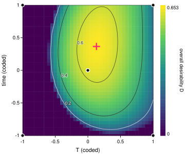

# Optimisation and robust design

## Desirability

Most processes have several responses, and the best settings for one are rarely the best for all.
**Desirability** (Derringer & Suich 1980) turns each response into a score d between 0
(unacceptable) and 1 (fully satisfactory), and combines them into one overall score D, the
weighted geometric mean of the d's — so any unacceptable response makes D = 0.

Each response's goal, on the Optimise step or with `doe goal`:

| goal | d = 0 | d = 1 |
|---|---|---|
| maximise | below *lower* | at or above *target* (or *upper*) |
| minimise | above *upper* | at or below *target* (or *lower*) |
| target | outside *lower* … *upper* | at *target* |
| in range | outside *lower* … *upper* | inside |

The **weight** shapes the curve between (1 linear; above 1 stricter, below 1 more lenient; two
weights for a target, below and above it), and the **importance** weights a response in D.

## Best settings

**Find best settings** searches for the settings with the largest D within the region — the
factor ranges (a cube), or a sphere, which suits a central composite design whose axial points
lie outside the cube — from many starting points, respecting constraints. Factors can be held at
a value. Each response's prediction is shown with its 95 % confidence interval: D is computed
from predictions, and the intervals say how sure they are. Confirm the result with
[confirmation runs](designs-sequential.md#confirmation-runs).

When a model has a [covariate](analysis.md#covariates), everything here is at its mean; give a
value under *covariates* (`--fix "id=value"` for `doe optimise`) to find the best settings for a
batch whose covariate you know ([best settings for a covariate value](analysis.md#best-settings-for-a-covariate-value)).

### Beyond the runs

A fitted model is only supported where there are runs. When the best settings (or settings you
type in) go beyond them, the Optimise step says so, in either of two ways:

- **outside the region of the runs**: the settings lie outside the convex hull of the runs — the
  smallest region with straight edges that contains them all — in the continuous factors. A
  sphere region, or a fraction that leaves corners of the cube unrun, can put the optimum there;
- **far from the runs**: inside that region, but the
  [scaled prediction variance](concepts.md#prediction-variance) of a fitted model there is larger
  than at any run — a gap in the design, where the prediction rests on few runs.

Either way the predicted D is an extrapolation: treat the settings as a direction to explore, and
run at or near them before relying on them. Augmenting the design towards them
([sequential designs](designs-sequential.md)) both checks the prediction and fills the gap.

When the best settings sit on the edge of the ranges because the response is still rising
there (a strong first-order fit, no curvature), the optimum is elsewhere. The *Moving to a better
region* panel on the Optimise step gives the path of steepest ascent from the centre and adds its
points as runs ([steepest ascent](designs-sequential.md#moving-to-a-better-region-steepest-ascent)).

## Profiler

The prediction profiler shows each response against each factor, with the others held at the
current settings, and the 95 % confidence band. Click a plot to move a factor; the dashed lines
mark each response's limits. It shows at a glance which factors matter for which response, and
where the trade-offs are.

## Overlay

The overlay plots D over two factors (the others at the current settings), with the regions
where some response is unacceptable greyed out: the sweet spot is the coloured region. The runs
are drawn on it as open circles, faded when their other factors differ from the current settings
(the filled circle); for a mixture, the triangle shows each run's shares of the three components.
A sweet spot with no runs near it rests on the model alone. The robustness map over two control
factors shows the runs the same way.
`doe plot STUDY --desirability A,B` draws it as SVG, the other factors at the best settings.

For the conversion study (one of the app's examples: maximise conversion, at least 74 %, and keep
the by-product low, at most 6 %), the goals pull apart — the by-product rises with temperature —
so the best settings sit below the conversion maximum:

```console
$ doe optimise examples/conversion-ccd.aikidoe.json
models: conv ~ quadratic; bypr ~ quadratic
region: cube

best settings: T=161.316, time=51.5617
overall desirability D = 0.6532
response  predicted  95% CI         goal                d
--------  ---------  -------------  -------------  ------
conv          78.72  77.74 … 79.71  max (74 → 80)  0.7868
bypr          3.831  3.556 … 4.106  min (2 ← 6)    0.5423
$ doe plot examples/conversion-ccd.aikidoe.json --desirability T,time --out conv-overlay.svg
overall desirability over T and time: up to 0.653; 9 runs drawn; ✚ the best settings (D = 0.653)
wrote conv-overlay.svg
```



## Robust design

A robust process is insensitive to things that vary in production. Two kinds of variation:

- **noise factors**: varied deliberately in the experiment, but random in production (ambient
  temperature, raw-material lot) — give each a standard deviation in production;
- **tolerances**: how far a control factor's actual value wanders from its setting (a flow
  controller's accuracy) — a standard deviation about the setting.

**Propagation of error** transmits this variation through the fitted surface: to second order,
the variance of the response at settings x is Σ gᵢ² σᵢ² + ½ Σ Hᵢⱼ² σᵢ² σⱼ² + σ², with g and H the
gradient and curvature of the surface and σ² the run-to-run variance. Settings where the surface
is flat in the noisy directions are robust. The Robustness panel shows the breakdown at the
current settings and the standard deviation over two control factors.

**Dual response** optimisation (Vining & Myers 1990; Lin & Tu 1995) then chooses settings for
both the mean and the standard deviation: the mean on target with the smallest standard
deviation; the smallest mean-squared error; or the largest (or smallest) mean with the standard
deviation below a limit. The standard deviation can come from propagation of error, or from a
fitted model of log s (per-wafer or replicate standard deviations).

### An example

Montgomery's filtration-rate experiment (*Design and Analysis of Experiments*, example 6.2): a 2⁴
factorial in temperature (A), pressure (B), formaldehyde concentration (C) and stirring rate (D).
Temperature is hard to control in the plant, so treat it as a noise factor with standard
deviation 1 (coded) and find concentration and stirring settings that keep the rate at 72 gal/h
with the least variation:

```console
$ doe init filt.aikidoe.json --factor A:-1:1 --factor B:-1:1 --factor C:-1:1 --factor D:-1:1 --response rate:gal/h --seed 6
created filt.aikidoe.json: 4 factors, 1 responses, seed 6
$ doe design filt.aikidoe.json --full
filt.aikidoe.json: full-factorial, 16 runs, randomisation complete, seed 6
```

```file filt.csv
run,rate
1,45
2,71
3,48
4,65
5,68
6,60
7,80
8,65
9,43
10,100
11,45
12,104
13,75
14,86
15,70
16,96
```

```console
$ doe import filt.aikidoe.json filt.csv
16 value(s) read (wide format)
filt.aikidoe.json: 16 observation(s)
$ doe robust filt.aikidoe.json --model "rate ~ A + C + D + A:C + A:D" --noise "A=1" --target 72 --fix B=0
mean model: rate ~ A + C + D + A:C + A:D; residual sd 4.417
sd by propagation of error: A noise sd 1

minimum sd with the mean on target 72:
settings: B=0, C=0.886867, D=-0.333867
mean 72, sd 4.417 (transmitted 0, residual 4.417)
source       sd  slope ∂y/∂x  % of variance
--------  -----  -----------  -------------
A             1            0              0
residual  4.417                         100
```

The fitted surface's slope in temperature is 10.81 − 9.06 C + 8.31 D (coded units); it vanishes
at these settings, so only the run-to-run variation (σ = 4.42) remains: the mean is on target and the
temperature no longer matters.

### Inner and outer arrays

Taguchi's way to find robust settings is a **crossed array**. The control factors (those you set
in production) are run in an **inner array**, the noise factors in an **outer array**, and every
inner run is tried at every outer condition. Each set of control settings then has a mean and a
spread over the noise. These are summarised by a **signal-to-noise ratio** (S/N, in dB):
- larger the better: −10 log₁₀ mean(1/y²);
- smaller the better: −10 log₁₀ mean(y²);
- nominal the best: 10 log₁₀(ȳ²/s²).

The **response table** gives the average S/N at each level of each control factor; the level
with the highest S/N is the most robust.

Mark the noise factors on the Define step (or give them a noise sd), and the Design step offers
the inner × outer array beside the other designs. On the command line:

```console
$ doe init coat.aikidoe.json --factor "temp=low,mid,high" --factor "time=short,mid,long" --factor "primer=none,thin,thick" --factor "humidity:30:70:%" --factor "lot:1:2" --response "thickness:um" --seed 7
created coat.aikidoe.json: 5 factors, 1 responses, seed 7
$ doe design coat.aikidoe.json --crossed --noise humidity,lot
coat.aikidoe.json: crossed-array, 36 runs, randomisation complete, seed 7
inner × outer array: L9 (3^4) for temp, time, primer × full factorial 2×2 for humidity, lot = 9 × 4 runs
note: a combined array — the noise factors in the same design, with control × noise interactions in the model, then propagation of error (doe robust) — usually needs far fewer runs
```

```file results.csv
run,thickness
1,44.9
2,52.7
3,47.4
4,55.0
5,48.9
6,52.7
7,51.3
8,55.0
9,52.8
10,52.8
11,55.2
12,55.2
13,50.0
14,53.6
15,52.3
16,56.1
17,53.7
18,54.0
19,56.0
20,56.5
21,51.9
22,59.8
23,54.2
24,62.3
25,54.2
26,55.4
27,56.5
28,57.9
29,52.5
30,61.2
31,54.8
32,63.6
33,56.2
34,61.4
35,58.6
36,63.8
```

```console
$ doe import coat.aikidoe.json results.csv
36 value(s) read (wide format)
coat.aikidoe.json: 36 observation(s)
$ doe sn coat.aikidoe.json --goal nominal
thickness: signal-to-noise ratio, nominal the best (dB), over the noise factors humidity, lot
temp  time   primer  n   mean      s    S/N
----  -----  ------  -  -----  -----  -----
low   short  none    4     50  4.657  20.62
low   mid    thin    4  51.97  2.555  26.17
low   long   thick   4     54  1.386  31.81
mid   short  thin    4     53  2.547  26.37
mid   mid    thick   4  55.05  1.406  31.86
mid   long   none    4  57.05  4.823  21.46
high  short  thick   4     56  1.577  31.01
high  mid    none    4  58.02  5.231   20.9
high  long   thin    4     60  3.307  25.18

response table: the average S/N at each level of each control factor
factor  level: S/N                                range  rank  best
------  ---------------------------------------  ------  ----  -----
temp    low: 26.2   mid: 26.56   high: 25.69     0.8656     2  mid
time    short: 26   mid: 26.31   long: 26.15     0.3112     3  mid
primer  none: 20.99   thin: 25.9   thick: 31.56   10.57     1  thick
note: the S/N ratio mixes the mean and the spread; check the mean and s too, or fit the response with control × noise interactions and use propagation of error (doe robust)
```

Here the primer has by far the largest range of S/N: a thick primer makes the thickness least
sensitive to humidity.

A crossed array is expensive (inner × outer runs, here 9 × 4 = 36). The S/N ratio also mixes the
mean and the spread, so the same value can come from different means (Box 1988). The usual
advice (Shoemaker, Tsui & Wu 1991; Myers, Montgomery & Anderson-Cook, ch. 11) is a **combined
array** instead: put the noise factors in an ordinary design with the control factors, and fit a
model with the **control × noise interactions**. A control factor that interacts with a noise
factor changes how much the noise matters. Propagation of error and dual response, above, then
find settings with the mean on target and the least spread. A combined array usually needs far
fewer runs. The default model for a crossed array is this response model, so both analyses are
available from the same runs.
